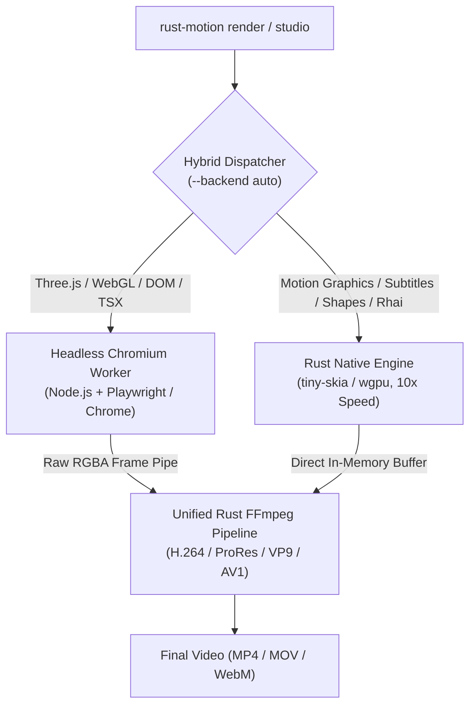

# Rust Motion Hybrid Rendering Architecture

Rust Motion incorporates a **Hybrid Rendering Pipeline** that bridges the gap between pure-Rust deterministic speed and full web-ecosystem compatibility (Three.js, WebGL, WebCodecs, Remotion parity).

---

## 🚀 The Hybrid Philosophy

Traditional programmatic video rendering forces a compromise:
- **Web-based engines (Remotion)** offer full HTML/CSS/WebGL capabilities, but suffer from heavy browser overhead and slower rasterization (3–10 fps).
- **Pure-native engines** render at blazing speeds (60–120+ fps), but cannot natively execute Three.js shaders or complex web DOM layouts without reimplementing the browser engine.

**Rust Motion solves this with a two-tier hybrid architecture:**



---

## ⚡ Tier 1: Pure Rust Native Engine (10x Faster)

For standard video editing, kinetic typography, subtitles, animated shapes, and complex transitions:
- **Rasterizer**: Pure Rust `tiny-skia` (CPU) or `wgpu` (GPU hardware accelerated).
- **Zero Browser Overhead**: No Chromium process, no JavaScript virtual machine, no DOM reflow.
- **Performance**: Up to **10x faster** than Headless Chrome. Renders 1080p60 frames in milliseconds.
- **Memory Footprint**: Extremely low (~30MB RAM vs 800MB+ for Chromium).

```bash
# Render native compositions with maximum speed
rust-motion render --composition HelloWorld -o out.mp4
rust-motion render --composition KaraokeCaptions --backend native -o captions.mp4
```

---

## 🌐 Tier 2: Headless Chromium Browser Worker (Remotion & Three.js Parity)

For 3D graphics, Three.js scenes, Canvas animations, or migrated Remotion components:
- **Worker**: Persistent headless Chromium worker (`scripts/three-render-worker.mjs`).
- **Autodiscovery**: Automatically detects system Chrome/Chromium binaries across macOS, Linux, and Windows.
- **Hardware Acceleration**: Full WebGL 2.0 and WebCodecs support.
- **Shared Memory / File Pipe**: Directly transfers raw uncompressed RGBA pixel buffers into Rust's FFmpeg pipe.

```bash
# Render Web & Three.js scenes with Chromium fidelity
rust-motion render --composition three_lifecycle_preview --backend browser -o 3d_scene.mp4
```

---

## 🧠 Smart Hybrid Dispatch (`--backend auto`)

Rust Motion automatically inspects compositions and projects to pick the optimal engine:
- If a composition name starts with `three_`, `web_`, `browser_`, `dom_`, or is a `.tsx`/`.html` module: **Chromium Browser** is automatically selected.
- If it is registered in the native registry, a Rhai script, or a standard timeline clip: **Rust Native** is automatically chosen for 10x throughput.
- You can always override this behavior with `--backend native` or `--backend browser`.

```bash
# Automatic routing based on composition requirements
rust-motion render --composition three_lifecycle_preview --backend auto -o out.mp4  # -> Uses Chromium
rust-motion render --composition KaraokeCaptions --backend auto -o out.mp4          # -> Uses Rust Native
```

---

## 🎬 Rust Motion Studio (`rust-motion studio`)

Instead of relying on heavy desktop WebView wrappers (Tauri / Electron) that require multi-gigabyte GTK/WebKit dependencies on Linux, Rust Motion provides a **zero-dependency lightweight Web Studio**:

```bash
# Launch the live studio in your default browser
rust-motion studio --port 1420
```

- **Live WebSocket Scrubber**: Scrub frames smoothly with millisecond preview.
- **Remotion Compatible**: Interactive preview running directly in real Chrome/Brave/Edge.
- **Zero OS Webview Bottlenecks**: Avoids WebKitGTK bugs and ensures snappy 60fps playback everywhere.
